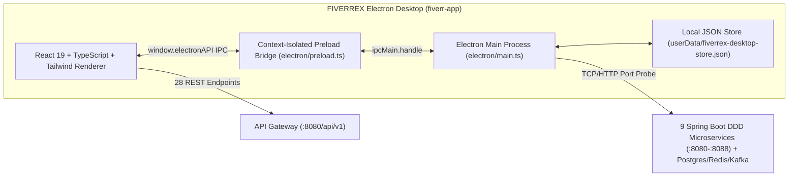

# FIVERREX Desktop (`fiverr-app`) — Electron Workstation

Cross-platform **Electron.js** desktop application (`https://www.electronjs.org/`) for the **Fiverr Club (`@fiverr-club`)** Freelance Services & Escrow Marketplace ecosystem.

---

## Architecture Overview



### Key Desktop Capabilities
1. **Context-Isolated Preload Bridge (`electron/preload.ts`)**:
   - Enforces `contextIsolation: true` and `nodeIntegration: false` following official Electron security guidelines.
   - Exposes `window.electronAPI` for native OS notifications, file dialogs, persistent userData storage, and cluster TCP port probing.
2. **Native File Dialogs & Escrow Ledger Receipts**:
   - **Export Official Escrow Receipt**: Uses `dialog.showSaveDialog` to save verifiable Markdown (`.md`) or JSON (`.json`) escrow receipts directly to disk.
   - **Attach Local Deliverable Artifacts**: Uses `dialog.showOpenDialog` in Seller View so freelancers can attach local `.zip`, `.tgz`, or `.pdf` artifacts to an order delivery.
3. **Global Command Palette (`⌘K` / `Ctrl+K`) & Native Menu Shortcuts**:
   - `⌘1` Marketplace Catalog & 3-Tier Gig Configurator
   - `⌘2` Orders & Escrow Saga Workspace
   - `⌘3` Real-Time Buyer & Seller Inbox
   - `⌘4` Seller Studio & Escrow Wallet
   - `⌘5` DDD Cluster & Desktop Telemetry Control Center
4. **Live DDD Microservice Cluster Telemetry**:
   - Probes all 13 Fiverr Club ports (`8080`–`8088`, `3000`, `5432`, `6379`, `9092`) from the Electron Main process and verifies strict DDD Hexagonal `domain/repository/*` contracts.

---

## Quick Start

```bash
cd /Users/huanchain/Documents/fiverr-club/fiverr-app

# 1. Install dependencies
npm install

# 2. Run in development mode (Vite HMR + Electron window)
npm run dev

# 3. Build production renderer (dist/) & Electron main/preload (dist-electron/)
npm run build

# 4. Launch production Electron desktop app
npm start

# 5. Run unit & DDD verification tests
npm test
```
